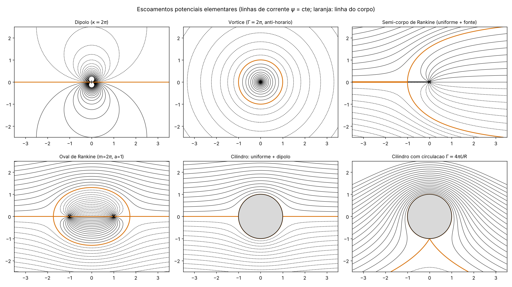
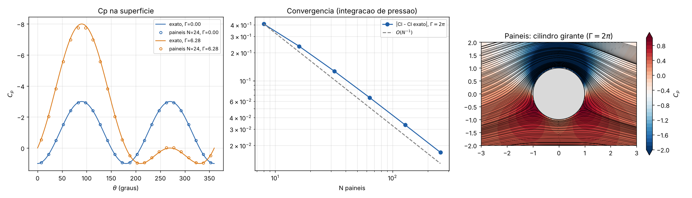
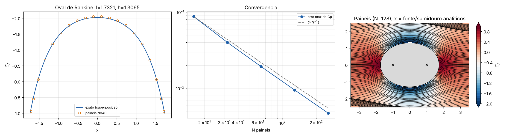
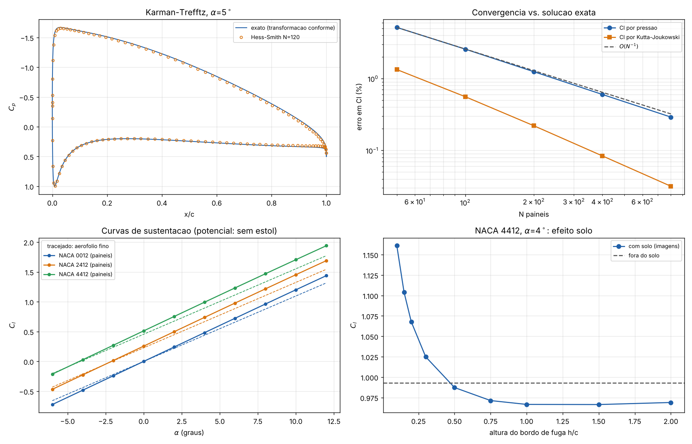
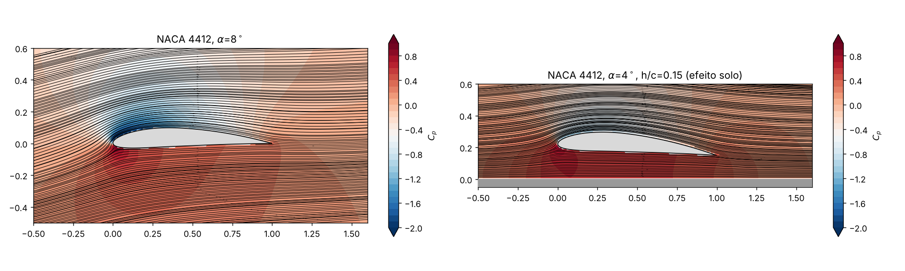
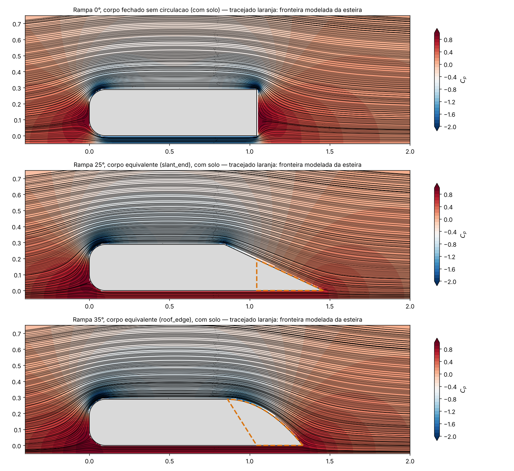
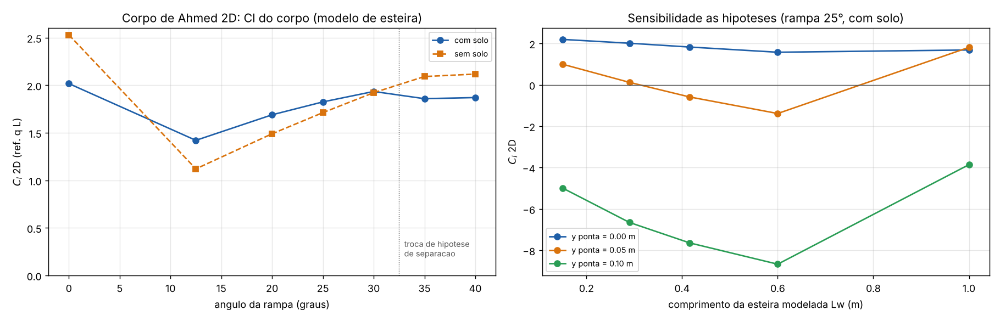
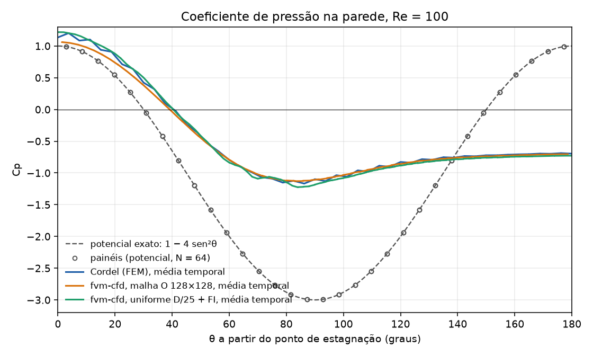

# panel_method — Método dos Painéis 2D por escoamento potencial

Código em Python (apenas `numpy` + `matplotlib`) que resolve escoamentos
bidimensionais **exclusivamente pela teoria do escoamento potencial**
(incompressível, invíscido e irrotacional: ∇²φ = 0), validado com casos
clássicos e aplicado a aerofólios e ao corpo de Ahmed.

> **Sobre o termo "laminar".** O escoamento potencial é *invíscido*: ele não tem
> camada-limite, então não é laminar nem turbulento no sentido viscoso. Ele
> representa bem o escoamento **fora da camada-limite** em corpos esbeltos com
> escoamento colado (ex.: aerofólios em ângulos pequenos). Consequências:
> arrasto nulo (paradoxo de d'Alembert), nenhuma previsão de estol ou separação,
> e a sustentação depende de uma hipótese externa (condição de Kutta).

## Instalação e uso

```bash
pip install -r requirements.txt
```

```bash
python -m pytest tests -q
```

```bash
for f in examples/0*.py; do python "$f"; done
```

Cada exemplo grava suas figuras e sua saída numérica (`saida.txt`) em uma
subpasta própria de `results/` (ver `results/README.md`).

```python
import numpy as np
from panelpy import Panels, solve, geometry as geo

p = Panels.from_points(*geo.naca4("2412", n=200))
sol = solve(p, alpha=np.radians(4))          # Hess-Smith + condição de Kutta
print(sol.forces())                          # cl, cd (~0), cm(c/4), cl_kj
```

## Estrutura

| Arquivo | Conteúdo |
|---|---|
| `panelpy/elementary.py` | Escoamentos elementares exatos: uniforme, fonte/sumidouro, vórtice, dipolo; superposição (φ, ψ, velocidade) |
| `panelpy/analytic.py` | Soluções exatas de referência: cilindro (com circulação), oval de Rankine, aerofólios de Joukowski e Kármán–Trefftz (transformação conforme), teoria do aerofólio fino |
| `panelpy/panels.py` | Painéis retos e coeficientes de influência analíticos de fontes e vórtices de intensidade constante (com imagens para efeito solo) |
| `panelpy/solver.py` | Método de fontes (corpos sem sustentação), Hess–Smith (fontes + vórtice uniforme + Kutta), circulação imposta, efeito solo; forças por integração de pressão |
| `panelpy/geometry.py` | Círculo, oval de Rankine, NACA 4 dígitos, Joukowski/Kármán–Trefftz |
| `panelpy/ahmed.py` | Perfil lateral 2D do corpo de Ahmed e modelo de "corpo equivalente" com esteira |
| `examples/01..05` | Casos de validação e aplicações |
| `trabalho_cilindro/` | Trabalho de disciplina: cilindro em Re = 100, painéis × Cordel × fvm-cfd (enunciado, gabarito, script de comparação) |
| `tests/test_validacao.py` | 18 testes automáticos contra as soluções exatas |

## Formulação

* Contorno discretizado em N painéis retos, nós em sentido horário a partir do
  bordo de fuga; normal externa n = (−t_y, t_x).
* Painel de fonte de intensidade σ constante, em coordenadas locais (ξ, η):
  u_ξ = (σ/2π) ln(r₁/r₂), u_η = (σ/2π)(θ₂ − θ₁). O vórtice de intensidade γ é a
  mesma velocidade girada de 90°. Autoinfluência: u_η = σ/2 (lado externo).
* **Corpos sem sustentação:** N equações de impenetrabilidade V·n = 0.
* **Hess–Smith:** N fontes + um γ uniforme; equação extra de Kutta
  V_t(1) + V_t(N) = 0 (velocidades iguais em módulo dos dois lados do bordo de fuga).
* **Efeito solo:** método das imagens — o campo induzido é somado ao seu reflexo
  em relação ao solo, o que garante v = 0 na parede (verificado em teste).
* Cp = 1 − (V_t/U)²; forças por integração de pressão. Cl também por
  Kutta–Joukowski (L' = ρUΓ), válido sem solo.

Referências de livro-texto (conteúdo clássico; não cito páginas específicas):
J. Katz & A. Plotkin, *Low-Speed Aerodynamics*; J. D. Anderson, *Fundamentals of
Aerodynamics*; J. L. Hess & A. M. O. Smith (1967), *Calculation of potential flow
about arbitrary bodies*, Progress in Aerospace Sciences 8 (referência citada de memória — confira).

## Resultados de validação

Números gerados pelos scripts (`results/<caso>/saida.txt`).

**Escoamentos elementares** (`01`): ψ = 0 na superfície do cilindro (erro 2e‑16);
oval de Rankine (m = 2π, a = 1, U = 1) com semicomprimento l = 1,73205 e
semiespessura h = 1,30654; circulação do vórtice por integral de linha igual à
exata; cilindro com circulação: Cl por pressão = Γ/(UR) (Kutta–Joukowski) e
Cd ≈ 1e‑16.

Cada caso tem sua própria pasta em `results/01_escoamentos_elementares/`
(`01a_dipolo`, `01b_vortice`, `01c_semicorpo_rankine`, `01d_oval_rankine`,
`01e_cilindro`, `01f_cilindro_circulacao`), com figura e `saida.txt`.



**Cilindro por painéis** (`02`): sem circulação, o Cp nos pontos de controle
coincide com 1 − 4 sin²θ até a precisão de máquina (consequência da simetria do
polígono regular). Com circulação imposta, o erro de Cl cai como O(1/N)
(0,41 → 0,017 de N = 8 a 256).



**Oval de Rankine por painéis** (`03`): erro máximo de Cp de 8,8e‑2 (N = 16) a
4,7e‑3 (N = 256), convergência ≈ O(1/N); Cd e Cl ~ 1e‑16.



**Aerofólios** (`04`):

* Kármán–Trefftz (bordo de fuga com 10°), α = 5°, Cl exato 1,25137: erro do
  Cl por pressão de 5,2% (N = 50) a 0,29% (N = 800), O(1/N); por
  Kutta–Joukowski, de 1,3% a 0,03%.
* Joukowski clássico (bordo de fuga em cúspide): converge bem mais devagar
  (Cl = 1,203 contra 1,218 com N = 1600). A cúspide é um caso difícil para painéis
  de intensidade constante.
* NACA 0012/2412/4412: ângulo de sustentação nula pelos painéis
  −2,13° e −4,26° contra −2,08° e −4,15° da teoria do aerofólio fino (calculados
  pelo próprio código); inclinação ≈ 6,87/rad (≈ 9% acima de 2π, efeito esperado da
  espessura em teoria potencial).
* Efeito solo, NACA 4412 a 4°: Cl sobe de 0,99 (fora do solo) para 1,16 com
  h/c = 0,1; para h/c entre ~0,5 e 2 o Cl potencial fica ligeiramente *abaixo*
  do valor fora do solo e volta a ele lentamente (o vórtice-imagem decai com 1/h).




## Corpo de Ahmed (`05`) — leia as limitações

O corpo de Ahmed é um corpo rombudo **3D** cujo escoamento é dominado por
separação, vórtices longitudinais nas arestas da rampa e esteira. Nada disso
existe em escoamento potencial 2D. O que o código faz é uma **estimativa sob
hipóteses explícitas**, usando o perfil lateral (plano de simetria) com as
dimensões que recordo de Ahmed, Ramm & Faltin (1984, SAE 840300): L = 1044 mm,
H = 288 mm, raio frontal 100 mm, rampa de 222 mm, folga ao solo 50 mm,
largura 389 mm. **Confira esses valores no artigo original.**

1. **Corpo fechado sem circulação:** força nula fora do solo (d'Alembert,
   verificado: |Cd| < 1e‑3) e Cl ≈ −0,35 a −0,41 com solo (sucção do canal sob
   o corpo).
2. **Kutta em uma única aresta traseira:** o resultado depende totalmente da
   aresta escolhida (Cl de +2,4 a −160 com solo). O problema é mal posto para
   uma base rombuda — mostrado como contraexemplo.
3. **Modelo de corpo equivalente** (recomendado): a região de água morta é
   substituída por uma carenagem que sai *tangente* à superfície nos pontos de
   separação e fecha numa ponta onde se aplica a condição de Kutta. Para rampas
   < 30° supõe-se escoamento colado na rampa; para > 30°, separação já na aresta
   teto/rampa (troca de regime que recordo da literatura por volta de 30°; confira).
   A pressão da região de água morta é tomada como a média do Cp nos pontos de
   separação.

Resultado com solo (Cl 2D por unidade de envergadura, referência q·L, N = 600;
convergido com a malha):

| Rampa | Separação | Cl corpo (com solo) | Cl corpo (sem solo) |
|---|---|---|---|
| 0° | fim do teto | 2,02 | 2,53 |
| 25° | fim da rampa | 1,83 | 1,71 |
| 30° | fim da rampa | 1,94 | 1,92 |
| 35° | aresta teto/rampa | 1,86 | 2,09 |

**Isso não deve ser lido como previsão quantitativa.** Pontos importantes:

* A **sensibilidade às hipóteses da esteira é enorme**: para a rampa de 25°,
  subir a ponta da esteira de 0 para 0,10 m muda o Cl de +1,8 para cerca de −7,6
  (gráfico à direita abaixo). Em 2D potencial, a sustentação é determinada pela
  circulação, que é determinada pela hipótese de Kutta/esteira, não pela física
  do escoamento separado.
* O comprimento padrão da esteira (prolongamento tangente da rampa) varia com o
  ângulo, o que também influencia a curva Cl × ângulo.
* O corpo real tem razão de aspecto W/L ≈ 0,37; efeitos 3D reduzem drasticamente
  a sustentação. Uma correção grosseira de asa de baixo alongamento (Helmbold,
  fator ≈ 0,09) leva a valores da ordem de 0,13–0,19 — use apenas como ordem de
  grandeza. **Não verifiquei esses números contra dados experimentais**;
  compare com as medições publicadas antes de tirar conclusões.
* O "arrasto" obtido com a hipótese de pressão de base é um subproduto do modelo
  e não deve ser comparado ao Cd experimental.




## Trabalho de disciplina: cilindro em Re = 100 (`trabalho_cilindro/`)

Enunciado de um trabalho de graduação que compara o escoamento potencial deste repositório
com duas soluções de Navier–Stokes de outros repositórios, no cilindro em Re = 100
(esteira de von Kármán): o [Cordel](https://github.com/lucianonoleto79/cordel) (elementos
finitos, CBS) e o [fvm-cfd](https://github.com/lucianonoleto79/fvm-cfd) (volumes finitos,
malha O e malha uniforme com fronteira imersa). Os painéis entram como referência invíscida
(Cp = 1 − 4 sen²θ, Cd = 0).

* [`trabalho_cilindro/enunciado.pdf`](trabalho_cilindro/enunciado.pdf): enunciado;
  [`gabarito.md`](trabalho_cilindro/gabarito.md): resultados de referência;
* `python trabalho_cilindro/comparar.py`: figuras e tabela em
  [`results/06_trabalho_cilindro/`](results/06_trabalho_cilindro/), a partir das rodadas dos
  outros dois repositórios (instruções em [`trabalho_cilindro/README.md`](trabalho_cilindro/README.md)).

Resultado: Cd = 1,387 (Cordel), 1,338 (malha O) e 1,451 (malha uniforme), contra 1,33–1,35 na
literatura; St = 0,170, 0,163 e 0,175 (literatura 0,164–0,165). As diferenças vêm sobretudo do
bloqueio do domínio e da representação da parede. O Cp viscoso só segue o potencial até
~20° do ponto de estagnação.



## Limitações gerais

* Painéis de intensidade constante: convergência de 1ª ordem nas forças.
* Sem viscosidade: sem arrasto, sem estol, sem separação (exceto quando imposta por
  modelo, como no corpo de Ahmed).
* Efeito solo exige α = 0 no escoamento livre (gire a geometria com `rotate`).
