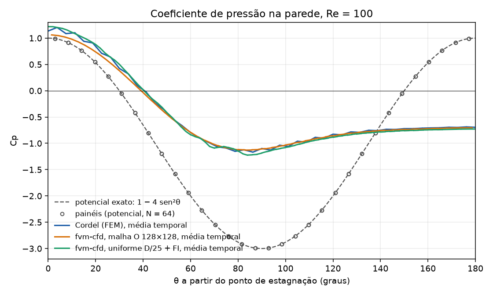
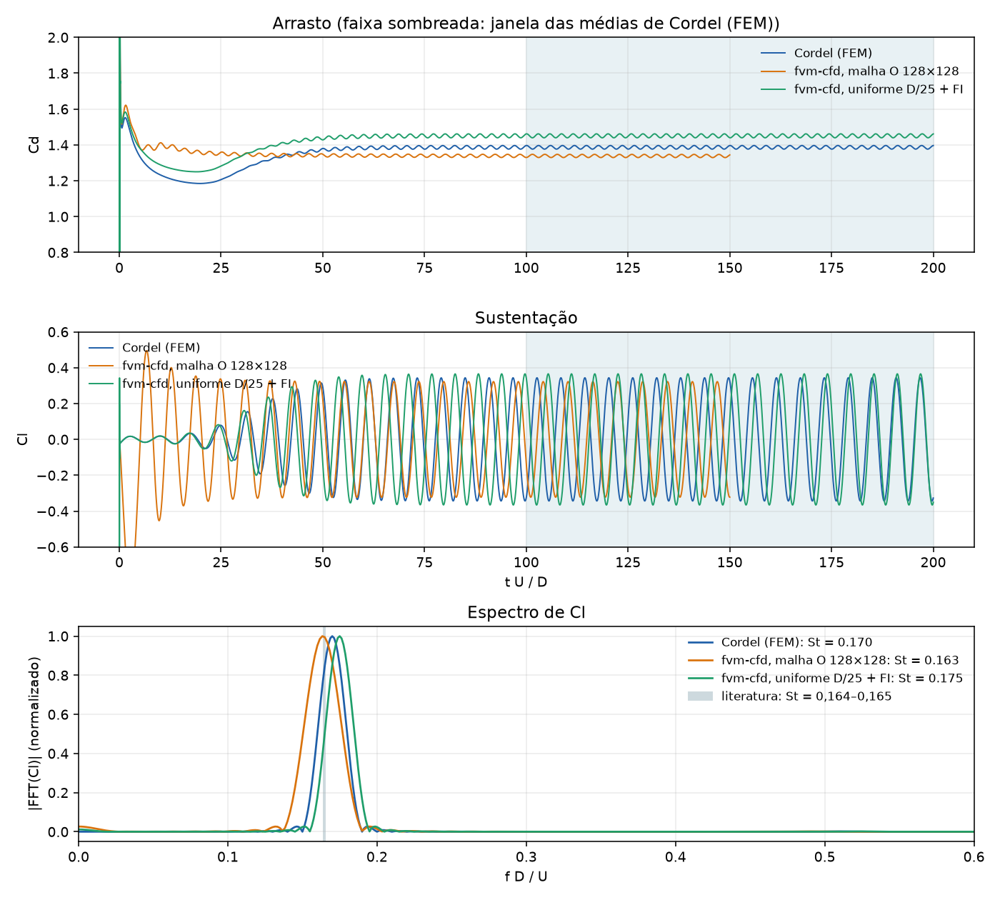

# Trabalho de CFD — cilindro 2D em Re = 100

Trabalho de disciplina de graduação que compara quatro soluções do escoamento em torno de um
cilindro circular (esteira de von Kármán, Re = 100):

| Solução | Repositório | Comando |
|---|---|---|
| escoamento potencial, método dos painéis | este | `python trabalho_cilindro/comparar.py` (resolve na hora) |
| Navier–Stokes, elementos finitos (CBS) | [cordel](https://github.com/lucianonoleto79/cordel) | `python cordel2008v4.py cylinder --tmax 200 --saida cylinder_trabalho` |
| Navier–Stokes, volumes finitos, malha O | [fvm-cfd](https://github.com/lucianonoleto79/fvm-cfd) | `python python/cylinder.py --NT 128` |
| Navier–Stokes, volumes finitos, malha uniforme + fronteira imersa | [fvm-cfd](https://github.com/lucianonoleto79/fvm-cfd) | `python python/cylinder2d.py --Re 100 --h 0.04` |

| Arquivo | Conteúdo |
|---|---|
| [`enunciado.md`](enunciado.md) / [`enunciado.pdf`](enunciado.pdf) | enunciado para os alunos (campos "[a definir]" para o professor) |
| [`gabarito.md`](gabarito.md) / [`gabarito.pdf`](gabarito.pdf) | resultados de referência e respostas esperadas (uso do professor) |
| [`comparar.py`](comparar.py) | lê as saídas dos códigos viscosos (repositórios irmãos), resolve o potencial e gera figuras e tabela em [`results/06_trabalho_cilindro/`](../results/06_trabalho_cilindro/) |
| [`gerar_pdf.py`](gerar_pdf.py), [`estilo.css`](estilo.css) | `python trabalho_cilindro/gerar_pdf.py [enunciado.md \| gabarito.md]` (pandoc ou o pacote `markdown` + Edge/Chrome sem janela) |

Os três repositórios devem estar lado a lado (`projetos_cfd/cordel`, `projetos_cfd/fvm-cfd`,
`projetos_cfd/panel_method/...`); outros caminhos: `--cordel` e `--fvm`. Sem os campos
`.npz` do fvm-cfd (não versionados), o script usa só o Cp (`cp_parede.csv`) e o
`resultados.json` de cada caso. Sem a rodada do Cordel, ele avisa e segue sem ela.

**Resultado** (Re = 100, médias na metade final; detalhes em [`gabarito.md`](gabarito.md)):

| | Cordel | fvm-cfd, malha O 128² | fvm-cfd, uniforme D/25 | painéis | literatura |
|---|---|---|---|---|---|
| Cd médio | 1,387 | 1,338 | 1,451 | 0 | 1,33–1,35 |
| St | 0,170 | 0,163 | 0,175 | — | 0,164–0,165 |
| Cp estagnação / mínimo / base | 1,135 / −1,168 / −0,696 | 1,061 / −1,129 / −0,705 | 1,218 / −1,226 / −0,728 | 1 / −3 / 1 | |

